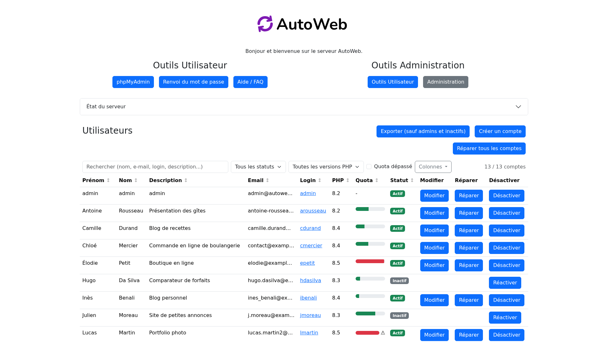

# AutoWeb

AutoWeb is a simple web hosting interface for Debian. It can host multiple users on their own subdomain. It is built to host small websites, or make a development lab.

## Documentation

The full documentation is at **https://auto-web.github.io/** ([version française](https://auto-web.github.io/fr/)).

You can find in this repository additional instructions for development and installation:

- [INSTALL.md](INSTALL.md): server installation;
- [UPGRADE.md](UPGRADE.md): upgrade, partial runs with tags, and one-time operations;
- [DEVELOPMENT.md](DEVELOPMENT.md): disposable development machine;
- [interface/README.md](interface/README.md): dependencies and database migrations of the web interface.
